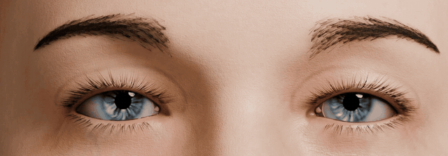
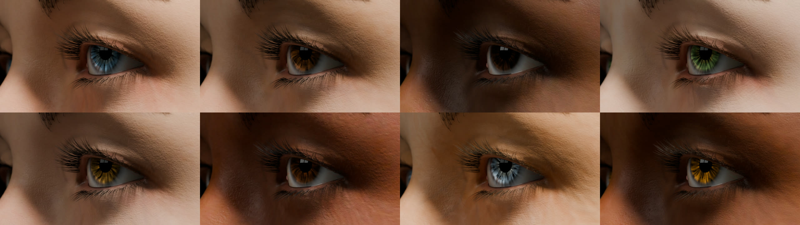
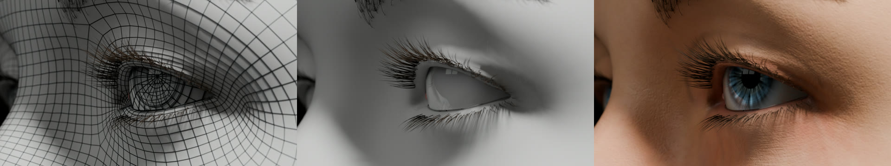

# TrueGaze

**Photoreal, animated synthetic eyes on Google's GNM head, built entirely by script.**
Samsung PRISM XR Hackathon 2026 · Track 1, Synthetic Eyes · Team Zero Drift, VIT Vellore

     



*`render.py --input "Generate Motion"`, first 6 s. Every pixel comes from this repo's code: no hand-painted texture, no hand-edited `.blend`.*

## At a glance

Every number below is printed by a script in this repo; the command is next to it.

| | Result | Check it with |
|---|---|---|
| Required outputs | **all 5**, plus the launch-spec API | table below |
| Texture sets | **8**, light to dark skin, six eye colours, left and right iris always distinct | `python3 -m truegaze.textures` |
| Seams on the face | **step of 4 of 255 or less** on all 8 sets (142 seam edges measured) | `python3 tools/seam_audit.py` |
| Eye motion | **15 of 15** numbers inside published ranges: saccades 5–30°, blink timing and rate, vergence, fixation drift | `python3 tools/evaluate_motion.py` |
| Launch-spec direction check | **5 of 5** (Left, Right, Up, Down, Reset), judged from the pupils found in the rendered pixels, not from our own labels | `wrapper/eyes.py -- --check` |
| Pupil labels vs. the image | **1.16 px** mean, 2.92 px max, between `pupil_center_2D` (refracted by the cornea) and the pupil found in each of the 10 frames | `outputs/launch_spec/metadata.json` → `label_error_px` |
| Skin fit onto GNM | **0.5 mm** median, lids and lip line pinned | `tools/transfer_skin.py` |
| UV portability | sets wrap onto stock and random GNM identities with none of our rig | `apply_textures.py` |
| Rebuild | **one command** from a fresh clone, downloads pinned by SHA-256 | `./reproduce.sh` |
| Tests | **16 passing** | `python3 -m pytest tests -q` |

## Watch

| Input | Video | Length |
|---|---|---|
| `Left` | [outputs/videos/Left.mp4](outputs/videos/Left.mp4) | 9 s |
| `Right` | [outputs/videos/Right.mp4](outputs/videos/Right.mp4) | 9 s |
| `Generate Motion` | [outputs/videos/Generate_Motion.mp4](outputs/videos/Generate_Motion.mp4) | 12 s |
| `Generate Motion`, close hero view | [outputs/videos/Generate_Motion_hero.mp4](outputs/videos/Generate_Motion_hero.mp4) | 12 s |
| `Generate Motion`, dark skin (set 03) | [outputs/videos/Generate_Motion_set03.mp4](outputs/videos/Generate_Motion_set03.mp4) | 12 s |
| `Generate Motion`, mesh drawn on top | [outputs/videos/Generate_Motion_wire.mp4](outputs/videos/Generate_Motion_wire.mp4) | 12 s |

Demo video (85 s, cut by `tools/make_demo.py`): *link added at submission.*





## Required outputs and where they are

| Required (Track 1 brief) | Where | Made by |
|---|---|---|
| 5–10 UV texture maps, face + distinct left/right iris | `textures/01` … `08`, one overview sheet each in `uv_maps/` | `python3 -m truegaze.textures` |
| Python script with inputs `Left`, `Right`, `Generate Motion` | `render.py` | — |
| A video for each input, ≤ 15 s | `outputs/videos/` (9, 9 and 12 s) | `render.py --all` |
| 5–10 renders with different textures | **the 8 required renders: `outputs/renders/01_front.png` … `08_front.png`**, one per texture set. The folder also holds 25 extra views: close and hero of every set, clay and wire of set 01, and 3 UV-portability proofs (33 PNGs in all) | `tools/stills.py` |
| `.blend` with an expression on the Timeline | `outputs/scene.blend` (eyes, lids, brows and pupil keyed; textures packed) | `render.py --input "Generate Motion" --blend outputs/scene.blend` |
| Launch spec: `eyes.move(h, v)`, `reset()`, `render()`, 10 clockwise frames at 1024², per-frame JSON | `wrapper/eyes.py`, `outputs/launch_spec/` | `wrapper/eyes.py -- --sequence outputs/launch_spec` |

## Submission package

| Asked for | Where |
|---|---|
| Working code in a public GitHub repo | this repo |
| README with reproducible setup and Docker file | this file, `reproduce.sh`, `Dockerfile` |
| Deck named `CollegeName_TeamName` | `VITVellore_ZeroDrift.pptx`, built from the organizers' template by `tools/make_deck.py` |
| Demo video, 3 minutes or less | `outputs/demo.mp4` (85 s, not in git; uploaded, link above) |
| Launch-spec bundle (`scene.blend`, `wrapper/eyes.py`, `renders/`, `metadata.json`, `README.md`) | `python3 tools/make_launch_zip.py` writes `VITVellore_ZeroDrift.zip` with exactly that layout at the zip root (plus `wrapper/truegaze/`, which `eyes.py` imports). Tested from a clean unzip: `blender --background scene.blend --python wrapper/eyes.py -- --check` passes 5 of 5 |

## Run it

Needs [Blender 4.5 LTS](https://www.blender.org/download/lts/4-5/), `ffmpeg`, and Python 3 with `pip install -r requirements.txt` (NumPy, SciPy, Pillow; only for building assets, rendering uses Blender's own Python).

```bash
./reproduce.sh draft      # everything from a fresh clone, draft quality (about 40 minutes on an M3)
./reproduce.sh            # final quality (hours)
```

One output at a time:

```bash
BLENDER=/Applications/Blender.app/Contents/MacOS/Blender   # or just "blender" on Linux
python3 -m truegaze.textures                                # 8 texture sets, about 3 minutes
$BLENDER --background --python render.py -- --input Left
$BLENDER --background --python render.py -- --input Right --texture 03
$BLENDER --background --python render.py -- --input "Generate Motion" --quality final
$BLENDER --background --python render.py -- --all
$BLENDER --background --python tools/stills.py -- 01 02 03
$BLENDER --background --python wrapper/eyes.py -- --sequence outputs/launch_spec
$BLENDER --background --python apply_textures.py -- --texture 05 --identity 3
python3 tools/seam_audit.py
python3 tools/evaluate_motion.py
python3 -m pytest tests -q
```

`render.py` options: `--seed N` (different natural blinks and micro-movements), `--frame screen|subject` (whose left "Left" means; default is the viewer's), `--quality draft|final`, `--texture 01..08`, `--view front|hero`, `--style textured|clay|wire`.

Final quality renders single frames with Cycles and joins them with `ffmpeg`. A stopped run resumes where it stopped: frame folders carry a fingerprint of the code and textures, so frames from an older look are never reused. Before joining, every frame is checked for black eyeballs (a Cycles fault seen once on long runs) and such frames are rendered again. About 25 s per frame on an M3 with 8 GB.

**Docker** (`Dockerfile`, x86-64 Linux, CPU rendering): `docker build -t truegaze . && docker run --rm -v "$PWD/outputs:/app/outputs" truegaze`. Tested 15 Nov on an M3 Mac under emulation with 4 GB: the image builds, asset fitting, the texture sets, the seam audit, the tests and Cycles stills run (about 2 minutes per still). Videos ran out of memory there; use a machine with more memory or run natively.

## Why it is different

- **Numbers, not adjectives.** Seams, saccades, blinks and the skin fit each have a script that prints the number and fails if it leaves its range.
- **Controls inside GNM's own space.** Blink, lid and brow controls are solved as mixes of GNM's 200 unnamed eye-expression components, so they work on any GNM face.
- **Skin moved in 3D, not painted.** Public-domain MakeHuman skins are carried onto GNM by fitting one head to the other (median 0.5 mm), then resampled into GNM's UV layout.
- **The eye pushes the face.** Fitted shapes sink the eye 2.9 mm into a socket, lift the lid 1.6 mm over the cornea and drag nearby skin up to 2.7 mm as the eye turns. Lashes follow the lid.
- **Nothing hand-made, licence-clean.** No hand-edited `.blend`, no painted texture, no photo or scan of an identifiable person. GNM is Apache 2.0, MakeHuman skins are CC0.

## Related work

Synthetic eyes for gaze research are an established line of work; TrueGaze sits with the scripted Blender pipelines.
- **SynthesEyes** (Wood et al., ICCV 2015) and **UnityEyes** (Wood et al., ETRA 2016): rendered eye regions with refracting corneas and randomised lighting, used to train gaze estimators.
- **EyeRender** (Świrski & Dodgson, 2014) and **RIT-Eyes** (Nair et al., 2020): Blender eye models with a refracting cornea and per-image pupil, iris and sclera labels. Both account for corneal refraction in their ground truth; our `pupil_center_2D` does too.
- **NVGaze** (Kim et al., CHI 2019) and **Microsoft Face Synthetics** (Wood et al., ICCV 2021): large rendered datasets; Face Synthetics reports landmark models trained on synthetic data alone matching real-data training.
- **GazeGene** (CVPR 2025): MetaHuman heads with full 3D eye labels (eyeball centre, optic axis, iris contour).

What TrueGaze adds within a hackathon budget: an open, Apache-licensed head (GNM) instead of a non-commercial one; controls solved inside GNM's own expression space; soft tissue that moves with the eye; motion checked against measured human ranges; and labels checked against the rendered pixels. We do not claim downstream gaze-estimation results: training and testing a gaze network on real data was out of scope.

## How it works

- **Head** (`truegaze/gnm.py`, `truegaze/scene.py`): GNM v3 read directly from Google's weights with NumPy and rebuilt in Blender: mesh, GNM's own UDIM UV layout, a four-bone rig. Eyeballs rotate about their real centres.
- **Eyelid and brow controls** (`tools/fit_controls.py`): blink, lid raise and lower, brow raise and lower, solved with a constraint that the lid never sinks into the eyeball.
- **Soft tissue** (`tools/fit_bulge.py`): socket depth, lid lift over the cornea, skin drag round the moving eyeball.
- **Textures** (`truegaze/textures.py`): per set, 4K skin colour, roughness and pore-height maps, and a 2K map per eye with sclera, veins, iris fibres, collarette and limbal ring. Left and right irises share colours but have their own patterns, as real eyes do. Seams are filled with skin in the photo's local tone.
- **Shading** (`truegaze/materials.py`): skin with subsurface scattering; a clear cornea that refracts, so the iris has depth and shifts with view angle; a wet lid margin and tear line; shadow under the upper lid; eye white shaded toward the corners; iris light pooling (a shader approximation, not traced caustics); expression wrinkles faded in by the same controls that move the face.
- **Lashes, brows, fine hair** (`tools/make_hair.py`): about 7,400 generated strands, tapered and curved, rebuilt for every control so lashes turn with the lid when it closes; plus the inner-corner tissue GNM lacks.
- **Motion** (`truegaze/motion.py`): saccades on the measured main sequence (25 ms + 2.4 ms per degree) with a small overshoot; both eyes converge on one 3D point; upper and lower lids follow vertical gaze; blinks close fast and open slowly, large gaze jumps trigger one, and the eyeball pulls back about 1 mm; fixation drifts with micro-saccades; pupils fluctuate; the head sways slightly while the eyes hold their target. Motion blur at a 180° shutter.
- **Hero view** (`--view hero`): one eye close up from its outer side, brow-shaded, shallow focus, in the style of the reference videos.
- **UV portability** (`apply_textures.py`): any set on a stock GNM head, including random GNM identities. Texture files are named by GNM's UDIM tile numbers.

## Results and limitations

What holds: all required outputs exist and rebuild from one script; seams, motion and direction checks pass as listed above; textures wrap onto heads they were not made on.

What a close look will still find (full list with scores: [`docs/SELF_AUDIT.md`](docs/SELF_AUDIT.md)):
- The iris reads as painted fibres rather than layered tissue; skin shows fine noise where real skin shows pores.
- In the hero view the eye white on the shadow side is flat.
- The upper lid creases in shading only; it does not fold into itself.
- The required videos use one face (set 01); set 03 has a fourth video, the other sets are stills.
- Motion is checked against published ranges, not against our own eye recordings. The head-sway range is our own choice.

## Repository layout

```
render.py            the required script: Left / Right / Generate Motion -> video
apply_textures.py    UV portability proof: a texture set on a stock GNM head
wrapper/eyes.py      launch-spec API: eyes.move / reset / render, 10-frame sequence
reproduce.sh         rebuilds every asset and output from a fresh clone
Dockerfile           the same in a container
truegaze/            library: GNM reader, scene, materials, textures, motion
tools/               asset fitting, hair, skin transfer, stills, audits, deck, demo
tests/               16 tests (motion, hair, textures)
textures/01..08/     the eight texture sets, files named by GNM UDIM tile
uv_maps/             one overview sheet per texture set
assets/              fitted controls, soft tissue, hair, skin lookup (rebuilt by tools/)
outputs/             videos/, renders/, scene.blend, launch_spec/
docs/                plan, design, asset licences, self-audit, organizer files
VITVellore_ZeroDrift.pptx   the deck
```

## Docs

Rules and rubric: [`docs/hackathondetails.md`](docs/hackathondetails.md) · design: [`docs/ARCHITECTURE.md`](docs/ARCHITECTURE.md) · decisions: [`DECISIONS.md`](DECISIONS.md) · asset licences: [`docs/ASSETS.md`](docs/ASSETS.md) · self-audit against the rubric: [`docs/SELF_AUDIT.md`](docs/SELF_AUDIT.md) · reference study: [`docs/reference_eye_piece.md`](docs/reference_eye_piece.md) · plan: [`docs/PLAN.md`](docs/PLAN.md) · task board: [`TASKS.md`](TASKS.md).

## Team

Team Zero Drift, VIT Vellore: Akshat Agrawal (23MIC0079), Hemang Dubey (23MIC0069), Ishita Solanki (23MID0443).

## Licence and credits

Code and generated assets: [Apache 2.0](LICENSE). Head model: [Google GNM](https://github.com/google/GNM) (Apache 2.0), downloaded on first run. Skin colour derived from [MakeHuman](http://www.makehuman.org/) skins (CC0 1.0). Details in [`docs/ASSETS.md`](docs/ASSETS.md).
