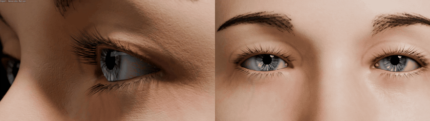
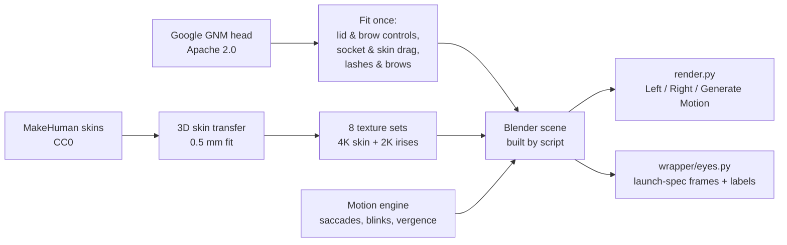

# TrueGaze

### Synthetic eyes that pass for human, and ship with pixel-exact ground truth.

**Samsung PRISM XR Hackathon 2026 · Track 1, Synthetic Eyes · Team Zero Drift, VIT Vellore**

     



*`render.py --input "Generate Motion"`. Every pixel comes from code in this repo: no hand-painted texture, no hand-edited `.blend`, no photo of a real person.*

**Demo video (2 min 48 s, narrated, captioned):** *link added at submission*

---

## The numbers

| | | |
|:---:|:---:|:---:|
| **5 / 5**<br>direction check, judged from the rendered pixels | **1.16 px**<br>mean pupil-label error over the 10 launch frames | **≤ 4 / 255**<br>seam step across all 8 skins |
| **322 people**<br>saccade timing within 10 ms of recorded humans | **15 / 15**<br>motion measures inside their target ranges | **1 command**<br>fresh clone to every output |

Every number is printed by a script in this repo. Commands and full tables: **[docs/RESULTS.md](docs/RESULTS.md)**.

## Why it beats the usual approach

| | Usual synthetic eyes | TrueGaze |
|---|---|---|
| Gaze | pupil texture slid in 2D | eyeballs rotate about their true centres, both converging on one 3D point |
| Pupil label | pinhole projection | refracted through a fitted cornea: **14 % lower error** against the rendered pupil |
| Motion | keyframed or linear | main-sequence saccades, blinks and drift, checked against **40,539 real saccades** |
| Lids and skin | static, or the cornea cuts through the lid | lids follow gaze, skin drags with the eye, lashes ride the lid |
| Texture | one hand-painted face | **8 skins**, light to dark, 6 eye colours, left and right iris always distinct |
| Portability | tied to one rig | wraps onto any GNM identity in GNM's own UDIM layout |
| Licence | often research-only (FLAME) | **Apache 2.0** head, **CC0** skins: shippable in a product |

## What it is for

The brief's problem: gaze estimators need huge labelled datasets, and capturing real eyes is slow, expensive and privacy-restricted. Eye images are biometric data.

- **Train headset eye tracking** (Galaxy XR, Android XR): every frame ships `eye_rotation_L/R`, a refracted `pupil_center_2D_L/R` and the `camera_matrix`. These are training pairs with no annotation cost.
- **Test fairness before launch:** known ground-truth gaze across 8 skin tones and 6 eye colours shows where a tracker drifts, before real users find it.
- **Zero privacy load:** no person is captured, so there is no consent, storage or deletion process to run.
- **Scale on a laptop:** seeds × 8 texture sets × any GNM identity give unbounded variety. Everything here was built and rendered on an 8 GB M3, with no GPU server.
- **Lifelike XR avatars:** the same motion engine gives avatars eyes that saccade, blink and converge like a person's.

## How it works



- **True 3D gaze:** eyeballs turn about their own centres; the lids, brows and skin follow.
- **Controls native to GNM:** blink, lid and brow shapes are solved inside GNM's 200 eye-expression components, so they work on any GNM face.
- **Physiology-timed motion:** saccades on the measured main sequence, blinks that close fast and open slow, fixation drift, micro-saccades, pupil hippus, motion blur.
- **Labels checked against pixels:** the direction check finds the pupils in the rendered image, not in our own metadata.

Deep dive: **[docs/HOW_IT_WORKS.md](docs/HOW_IT_WORKS.md)** · module map: [docs/ARCHITECTURE.md](docs/ARCHITECTURE.md)

## Eight people, one pipeline


## Run it

```bash
./reproduce.sh draft                                                   # everything, from a fresh clone
blender --background --python render.py -- --input "Generate Motion"
blender --background outputs/launch_spec/scene.blend --python wrapper/eyes.py -- --check
```

Setup, every command and Docker: **[docs/RUN.md](docs/RUN.md)** · required outputs and the videos: **[docs/OUTPUTS.md](docs/OUTPUTS.md)**

## Repository

```
render.py          Left / Right / Generate Motion -> video
wrapper/eyes.py    launch-spec API: move, reset, render, 10-frame sequence + labels
apply_textures.py  any texture set on a stock GNM head
reproduce.sh       rebuilds every asset and output
truegaze/          GNM reader, scene, materials, textures, motion
tools/             fitting, hair, skin transfer, stills, audits, deck, demo
textures/ uv_maps/ the 8 texture sets, named by GNM UDIM tile
outputs/           videos/, renders/, scene.blend, launch_spec/
docs/              results, how it works, run, outputs, assets
```

## Team

**Team Zero Drift, VIT Vellore:** Akshat Agrawal (23MIC0079) · Hemang Dubey (23MIC0069) · Ishita Solanki (23MID0443)

## Licence

Code and generated assets: [Apache 2.0](LICENSE). Head: [Google GNM](https://github.com/google/GNM) (Apache 2.0), downloaded on first run. Skin colour from [MakeHuman](http://www.makehuman.org/) skins (CC0). Motion reference data: [GazeBase](https://doi.org/10.6084/m9.figshare.12912257) (CC BY 4.0, not redistributed). Details: [docs/ASSETS.md](docs/ASSETS.md).
