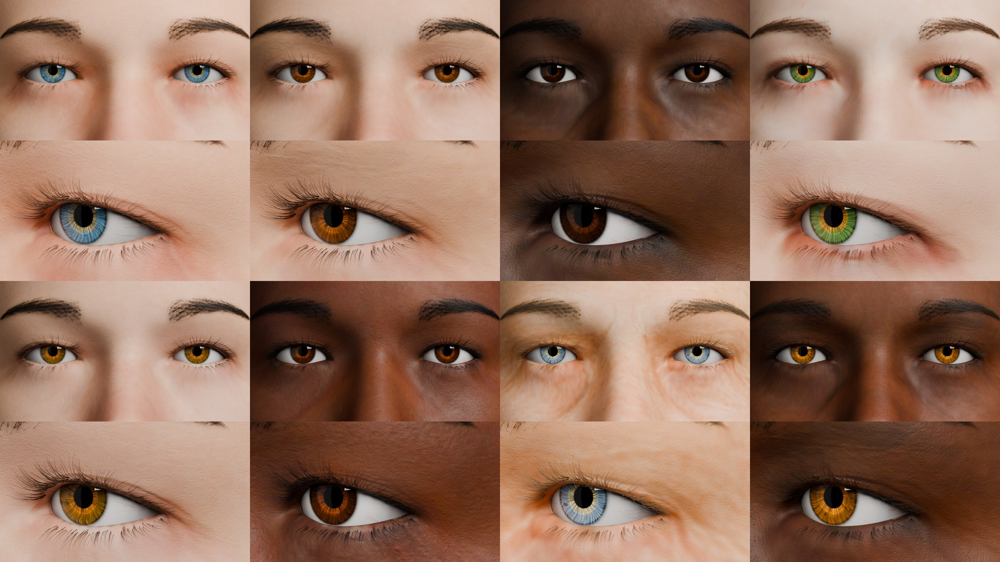

# TrueGaze

Photoreal, animated synthetic eyes on Google's GNM head. Samsung PRISM XR Hackathon 2026, Track 1 (Synthetic Eyes). Team Zero Drift, VIT Vellore.

Everything is generated by scripts in this repo: textures, eyelid controls, lashes, motion, renders. Outside inputs: Google's GNM head model (Apache 2.0) and MakeHuman's public-domain (CC0) skin textures, both downloaded and checksum-verified on first run. No photo or scan of an identifiable person is used.





## Required outputs and where they are

| Required | Where | Made by |
|---|---|---|
| 5–10 UV texture maps, face + distinct left/right iris | `textures/01`…`08` (overview sheets in `uv_maps/`) | `python3 -m truegaze.textures` |
| Python script with inputs `Left`, `Right`, `Generate Motion` | `render.py` | — |
| Video for each input, ≤ 15 s | `outputs/videos/` | `render.py --all` |
| 5–10 renders with different textures | `outputs/renders/` (front, close and hero view per set; wire and clay for set 01) | `tools/stills.py` |
| `.blend` with an expression on the Timeline | `outputs/scene.blend` | `render.py --input "Generate Motion" --blend outputs/scene.blend` |
| Launch-spec API, 10-frame sequence, metadata | `wrapper/eyes.py`, `outputs/launch_spec/` | `wrapper/eyes.py -- --sequence` |

## Run it

Everything in one go from a fresh clone (verified 13 Nov: tests pass, model and skin files download with checksums, fits reproduce bit-for-bit): `./reproduce.sh` (final quality, hours) or `./reproduce.sh draft`.

Needs Blender 4.5 LTS and Python 3 with `numpy scipy pillow` (only for generating assets; rendering uses Blender's own Python).

```bash
python3 -m truegaze.textures          # 8 texture sets, about 3 minutes
BLENDER=/Applications/Blender.app/Contents/MacOS/Blender   # or just "blender" on Linux
$BLENDER --background --python render.py -- --input Left
$BLENDER --background --python render.py -- --input Right --texture 03
$BLENDER --background --python render.py -- --input "Generate Motion" --quality final
$BLENDER --background --python render.py -- --all
$BLENDER --background --python tools/stills.py -- 01 02 03
$BLENDER --background --python wrapper/eyes.py -- --sequence outputs/launch_spec
$BLENDER --background --python apply_textures.py -- --texture 05 --identity 3
python3 tools/seam_audit.py
python3 tools/evaluate_motion.py
python3 -m pytest tests -q
```

Final quality (`--quality final`) renders single frames with Cycles and joins them with `ffmpeg`; a stopped run resumes. About 10 s per frame on an M3.

`render.py` options: `--seed N` (different natural blinks and micro-movements), `--frame screen|subject` (whose left "Left" means; default is the viewer's), `--quality draft|final`, `--texture 01..08`.

## How it works

- **Head** (`truegaze/gnm.py`, `truegaze/scene.py`): GNM v3 read directly from Google's weights with NumPy and rebuilt in Blender: mesh, GNM's own UDIM UV layout, a four-bone rig. Eyeballs rotate about their real centres.
- **Eyelid and brow controls** (`tools/fit_controls.py`): GNM's eye expressions are 200 unnamed statistical components. We solve for blink, lid raise/lower and brow raise/lower as combinations of them, with a constraint that the lid never sinks into the eyeball. The controls live in GNM's own expression space, so they work on any GNM head.
- **Soft tissue** (`tools/fit_bulge.py`): the eye sits in a socket (GNM's puffy template lids are sunk by up to 2.9 mm); the lid skin lifts over the cornea as the eye turns; and skin near the lid edge is dragged up to 1.4 mm round with the eyeball, so the skin around a moving eye stretches and slides.
- **Hero view**: `--view hero` (and a hero still per set) frames one eye from its outer side with hard raking light and shallow focus, like the reference videos.
- **Making-of looks**: `--style clay` and `--style wire` on `render.py` and `tools/stills.py` render the same animation as grey shape or with the mesh drawn on top.
- **Skin transfer** (`tools/transfer_skin.py`): MakeHuman's CC0 skins are drawn for a different head. We fit the GNM head to MakeHuman's in 3D (eyelid edges, lip line and nose tip pinned; median error 0.5 mm) and resample each skin into GNM's UV layout.
- **Textures** (`truegaze/textures.py`): each set has 4K skin colour (photo-based), roughness and pore-height maps, and a 2K map per eye with sclera, veins, iris fibres, collarette and limbal ring. Left and right irises share colours but have their own patterns, as real eyes do.
- **Shading** (`truegaze/materials.py`): skin with subsurface scattering; a clear cornea that refracts, so the iris has depth and shifts with view angle.
- **Lashes, brows, tear line** (`tools/make_hair.py`): about 3,000 lash and brow strands, 4,500 fine facial hairs, a wet bead along each lid edge and the pink inner-corner tissue GNM lacks. They are rebuilt for every control, so lashes turn with the lid when it closes.
- **Motion** (`truegaze/motion.py`): saccades follow the measured main sequence (duration 25 ms + 2.4 ms per degree, the middle of published fits) with a small overshoot; both eyes converge on one point; upper lids follow vertical gaze; blinks close fast and open slowly, and large gaze jumps trigger one; fixation is never frozen (drift and micro-saccades); pupils fluctuate. `tools/evaluate_motion.py` checks these numbers against published ranges.
- **UV portability** (`apply_textures.py`): wraps any set onto a stock GNM head, including random GNM identities, with none of our rig on it. Texture files are named by GNM's UDIM tile numbers.

## Docs

Plan: `docs/PLAN.md` · design: `docs/ARCHITECTURE.md` · decisions: `DECISIONS.md` · asset licences: `docs/ASSETS.md` · task board: `TASKS.md`.
