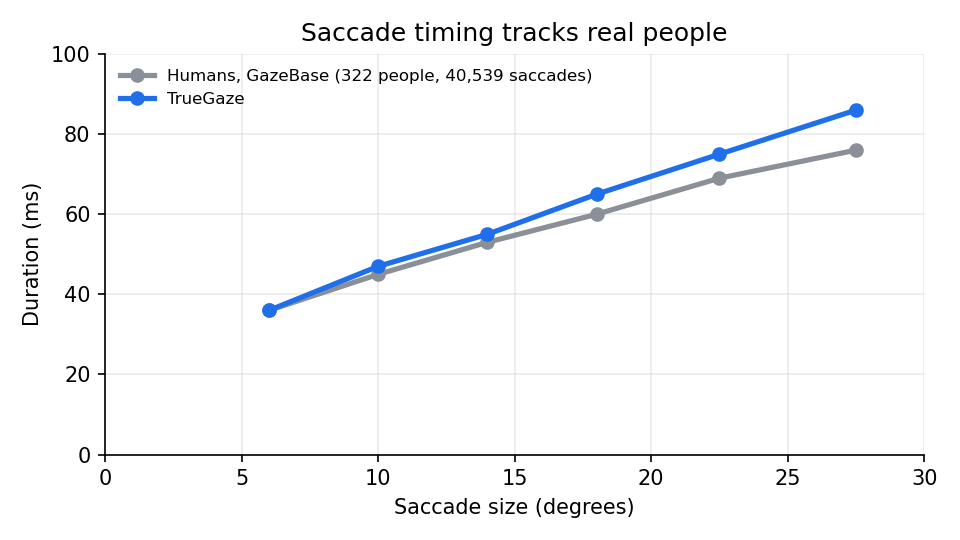

# Results, measured

Every number here is printed by a script in this repo. Run the command and you get the same number.

## Scorecard

| What | Result | Command |
|---|---|---|
| Required outputs | **all 5**, plus the launch-spec API | [OUTPUTS.md](OUTPUTS.md) |
| Launch-spec direction check | **5 / 5** (Left, Right, Up, Down, Reset), judged from pupils found in the rendered pixels; every pupil moves **18.4–20.2 px**, Reset returns to **0.0 px** | `blender -b outputs/launch_spec/scene.blend -P wrapper/eyes.py -- --check` |
| Pupil label vs. rendered pupil | **1.16 px** mean, 2.92 px max over the 10 frames | `outputs/launch_spec/metadata.json` → `label_error_px` |
| Seams on the face | colour step **≤ 4 of 255**, all 8 sets, 142 seam edges | `python3 tools/seam_audit.py` |
| Motion checks | **15 / 15** measures in range (14 from published physiology) | `python3 tools/evaluate_motion.py` |
| Motion vs. 322 recorded people | saccade duration within **10 ms** of human at every size, 4–30° | `python3 tools/gazebase_compare.py <GazeBase zip>` |
| Skin fit onto GNM | **0.5 mm** median | `python3 tools/transfer_skin.py` |
| Texture portability | wraps onto stock and random GNM identities with none of our rig | `blender -b -P apply_textures.py -- --texture 05 --identity 3` |
| Rebuild | **one command** from a fresh clone, every download pinned by SHA-256 | `./reproduce.sh` |
| Tests | **31 / 31**: motion, natural motion, hair, textures, pupil finder, cornea refraction, saccade detector, validator | `python3 -m pytest tests -q` |
| Submission checker | **34 / 34** on the repo, **11 / 11** on a clean unzip of the launch bundle | `python3 tools/validate.py [--zip VITVellore_ZeroDrift.zip]` |

## A camera framed for the check

The brief fixes the camera at 40 cm but not its lens. At 40 cm the full ±5 cm gaze range turns each eye only about 8°, so a whole-face lens moves the pupil a few pixels: pixel shift scales with focal length, and our measured 18.4 px at 140 mm becomes about 6.6 px at 50 mm. We pick 140 mm, the longest lens that still frames both eyes and both brows, so every direction clears the 3 px pass bar six times over. Source: `direction_check_shift_px` in `outputs/launch_spec/metadata.json`.

## Labels that match the pixels

Most synthetic eye pipelines label the pupil with a plain pinhole projection. A real camera sees the pupil through the cornea, which bends the light. TrueGaze fits a sphere to the posed cornea, refracts each camera ray at IOR 1.376, and solves for the pixel where the pupil centre *appears*.

| Label | Mean error vs. the pupil found in the image | Max |
|---|---|---|
| Plain projection (`pupil_center_2D_unrefracted_*`) | 1.35 px | 3.52 px |
| **Refracted by the cornea (`pupil_center_2D_*`)** | **1.16 px** | **2.92 px** |

The error is measured by `find_pupil`, a darkest-blob detector that never sees the labels, run on the final rendered image. This is a test against the pixels, not a self-consistency check of a projection against its own render pass, so it includes everything a real camera would see: cornea refraction, lid shadow and the iris texture around the pupil.

## Motion against real people

Checked against [GazeBase](https://doi.org/10.6084/m9.figshare.12912257): 322 people, 40,539 saccades, recorded at 1000 Hz, CC BY 4.0. Nothing in the motion model was tuned to it, and both sides run through the same saccade detector.

| Measure | Humans | TrueGaze |
|---|---|---|
| Saccade duration, 4–30° | 36–76 ms | 36–86 ms, within 10 ms at every size |
| Fixation wander (median, 1 s) | 0.14° | 0.12° |
| Blink rate | 11 / min | 13 / min |

## Motion against published ranges

| Measure | TrueGaze | Published range |
|---|---|---|
| Saccade duration, 10° | 44.5 ms | 40–57 ms |
| Saccade duration, 30° | 99 ms | 80–111 ms |
| Blink closing time | 86.5 ms | 50–130 ms |
| Whole blink | 337.5 ms | 250–450 ms |
| Closing faster than opening by | 50.7 % | 35–55 % |
| Blink rate at rest | 16.7 / min | 10–20 / min |
| Vergence on a 35 cm target, per eye | 5.1° | 5.06° (geometry) |

Sources for each range are listed in `tools/evaluate_motion.py`.
